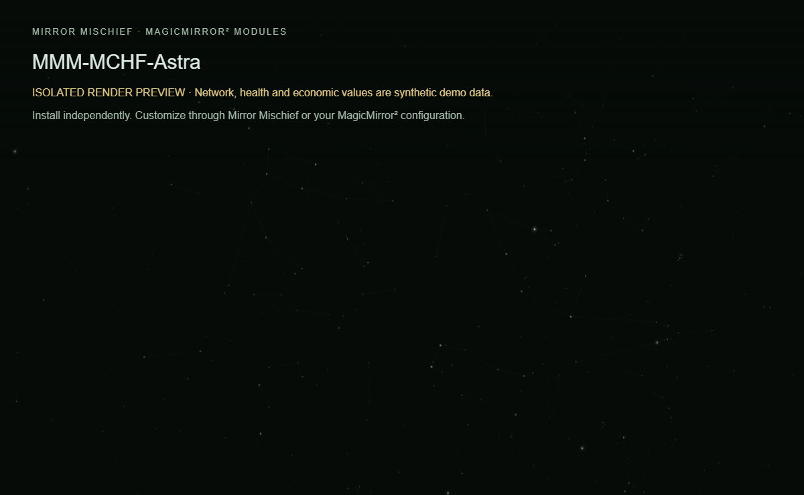

# MMM-MCHF-Astra

A dim local star canopy with configurable location and motion.

**MCHF means Mischief.** Part of [Mirror Mischief](https://github.com/FoggEyez/Mirror-Mischief). Install and configure manually, or use the optional companion.



Screenshot uses the actual module renderer in an isolated preview. Network/health/economy readings are labelled synthetic demonstration data, not live readings.

## Install

Requires a working MagicMirror² installation, Node.js 22 or newer, and a current browser. Development baseline: MagicMirror² 2.38.0 API. Physical-device compatibility of this newly packaged version remains to be verified; see VALIDATION.md.

```sh
cd ~/MagicMirror/modules
git clone https://github.com/FoggEyez/MMM-MCHF-Astra.git
```

No npm runtime dependencies or install scripts. No extra services are required.

Add this to the modules array in config/config.js, then restart MagicMirror²:

```js
{
  module: "MMM-MCHF-Astra",
  position: "fullscreen_below",
  config: {}
}
```

## Customize

Set `latitude` (−90 to 90) and `longitude` (−180 to 180) for your sky. The neutral default is Greenwich, not automatic location detection. Use `motionSpeed: 1` for real time, 0 for a still epoch, or up to 30 for faster motion. `fps` is clamped to 1–6. North is up, east is left; use rotation to orient the canopy. Hidden pages pause drawing and reduced-motion preferences slow updates. This is a clear-sky visualization, including daytime; it does not predict clouds or visibility.

All supported settings are visible as literal defaults for generated settings editors.

| Setting | Default | Type |
| --- | --- | --- |
| latitude | `51.4769` | number |
| longitude | `0` | number |
| brightness | `32` | number |
| constellationOpacity | `12` | number |
| showConstellations | `true` | boolean |
| starMagnitude | `4.8` | number |
| motionSpeed | `6` | number |
| rotation | `0` | number |
| fps | `1` | number |

## Mirror Mischief companion

Part of [Mirror Mischief](https://github.com/FoggEyez/Mirror-Mischief), a companion designed to make module installation, settings and layout easier. See [MIRROR-MISCHIEF.md](MIRROR-MISCHIEF.md) for setup and availability.

In Mirror Mischief, choose Install from a link, paste this repository URL, then open Module settings. Set your preferences and position, save and run Check setup. The repository folder, JavaScript entry and Module.register name match exactly. companion.json describes supported placement and dependencies; the current companion reads defaults from JavaScript, not this manifest. One instance per mirror is supported in this release; helpers share one configuration per module. For renamed legacy modules, install this version turned off first and disable the legacy counterpart before enabling it. All public modules now use MMM-MCHF names, including Luna and Wit. GitHub redirects do not rename installed folders or config entries. Keep a configuration backup, install the newly named folder, transfer supported settings and disable the earlier counterpart before enabling its replacement. No automatic config migration or removal occurs. Ordinary MagicMirror² configuration works without the companion.

## APIs, privacy and cost

None. Offline with bundled star catalog and astronomy routines; no API key or account.

No telemetry or analytics is added by Mischief. Keep private configuration, tokens and collector snapshots outside this repository.

## Update or remove

Review CHANGELOG.md, back up your private config and local customizations, then run git pull --ff-only inside this module folder and restart MagicMirror². To remove, disable/remove its config entry and restart; retain the folder for rollback or uninstall it using your companion. Never overwrite private configuration from an example.

## Development and support

Run npm ci and npm test. See CONTRIBUTING.md and VALIDATION.md. Report reproducible issues through this repository's Issues tab; remove secrets and private addresses.

## Credits and license

Based on [MMM-NightSky](https://github.com/charleswest775/MMM-NightSky) astronomy and catalog, MIT license retained in vendor/LICENSE-NightSky. The star data includes d3-celestial by Olaf Frohn under its BSD license, preserved at the top of vendor/stars.js, with XHIP, VizieR and IAU attribution.

Original Mischief code: MIT, Copyright 2026 FoggEyez. Third-party licenses and data credits remain applicable; see THIRD_PARTY_NOTICES.md.

## Help and troubleshooting

See [TROUBLESHOOTING.md](TROUBLESHOOTING.md) for common states and setup checks. [Open an issue](https://github.com/FoggEyez/MMM-MCHF-Astra/issues) with a minimal configuration that has secrets removed.
